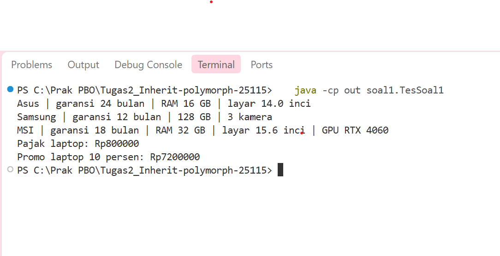
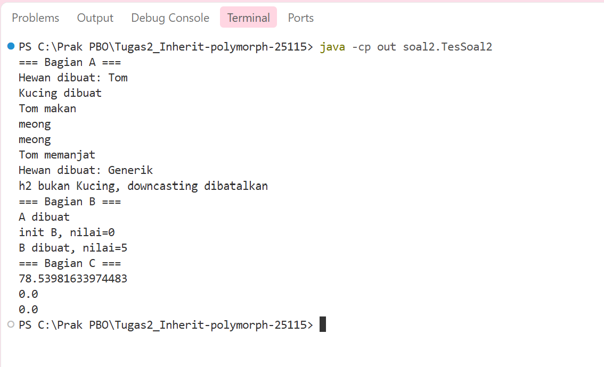
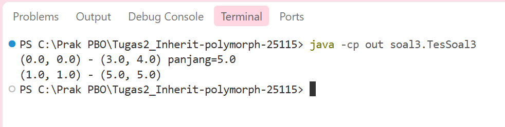
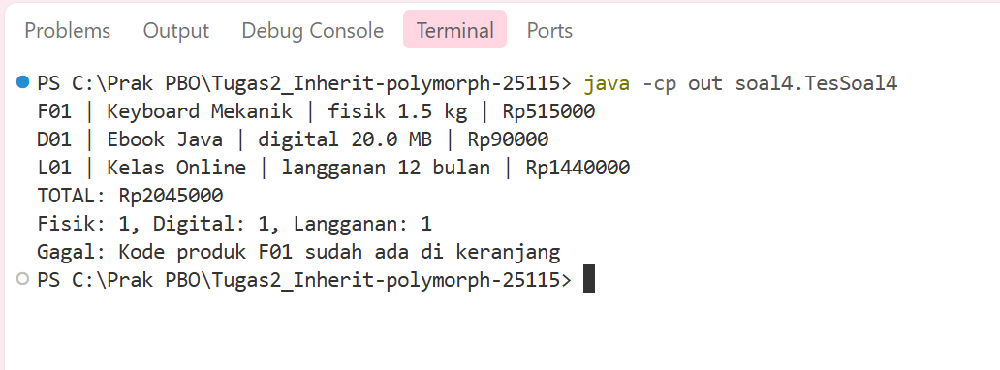

# Tugas 2 Praktikum PBO: Inheritance, Composition, dan Polimorfisme

- Nama: Najla Putri Syahnuza
- NPM: 250810701100115
- Kelas Praktikum: A
- Repository: https://github.com/najlasyahnuza/Tugas2_Inherit-polymorph-25115

## Deskripsi
Tugas ini berisi empat soal latihan: hierarki perangkat elektronik, analisis output dan polimorfisme, titik dan garis, serta mini project toko digital. Konsep yang dilatih adalah inheritance, composition, polimorfisme, downcasting aman, dan penanganan exception.

## Fitur Utama
- Soal 1: menampilkan info singkat laptop, ponsel, dan laptop gaming (garansi tambahan otomatis), menghitung pajak 10 persen dan harga promo laptop.
- Soal 2: mendemonstrasikan urutan pembuatan objek, pemanggilan method yang di-override, dan perbedaan hasil antara lingkaran dan titik.
- Soal 3: membuat garis dari dua titik, menghitung panjang, dan menjaga isi garis tetap aman dari perubahan titik di luar.
- Soal 4: menyimpan produk fisik, digital, dan langganan dalam satu keranjang, mencetak struk dan total, menghitung jumlah per jenis, serta menolak kode produk ganda.

## Konsep OOP yang Diterapkan
| Konsep | Dipakai di | Alasan |
|---|---|---|
| Inheritance (multi level) | `Perangkat` > `Laptop` > `LaptopGaming` | laptop gaming adalah laptop, laptop adalah perangkat, jadi atribut dan perilaku dasar tidak ditulis ulang |
| `protected` | `harga` di `Perangkat`, dipakai `Laptop.hitungHargaPromo` | subclass perlu akses langsung ke harga, sedangkan kelas lain tetap tidak bisa |
| `super(...)` dan `super.infoSingkat()` | semua constructor dan `infoSingkat()` subclass Soal 1 | memakai ulang logika superclass tanpa menyalin kode |
| Overriding | `infoSingkat()` Soal 1, `suara()` Soal 2, `hitungHargaAkhir()` dan `deskripsi()` Soal 4 | tiap subclass punya perilaku sendiri untuk method yang sama |
| Overloading | constructor `Titik` dan `Garis` Soal 3 | objek bisa dibuat dengan cara berbeda, constructor kedua memanggil yang pertama lewat `this(...)` |
| Composition (has-a) | `Garis` memiliki dua `Titik`, `Keranjang` memiliki daftar `Produk` | garis bukan titik dan keranjang bukan produk, jadi relasinya has-a |
| Polimorfisme | `Keranjang.cetakStruk()` dan `hitungTotal()` | satu perulangan atas `Produk` memanggil versi method yang sesuai tanpa `instanceof` |
| `instanceof` | `Keranjang.hitungPerJenis()` dan Soal 2 bagian A | jenis objek dicek dulu supaya tidak terjadi `ClassCastException` |
| Defensive copy | `Garis` Soal 3 | isi garis tidak berubah ketika titik asli di luar diubah |
| Exception | constructor semua kelas, `Keranjang.tambah()` | data tidak valid ditolak dengan pesan yang jelas |

## Struktur Project
```
Tugas2_Inherit-polymorph-25115/
  src/
    soal1/  Perangkat, Laptop, Ponsel, LaptopGaming, TesSoal1
    soal2/  Hewan, Kucing, A, B, Lingkaran, Titik, TesSoal2
    soal3/  Titik, Garis, TesSoal3
    soal4/  Produk, ProdukFisik, ProdukDigital, Langganan, Keranjang, TesSoal4
  screenshot/  soal1.png, soal2.png, soal3.png, soal4.png
  .gitignore
  README.md
```

## Prasyarat
- JDK 21 (Temurin 21.0.12)
- Visual Studio Code dengan Extension Pack for Java (dipakai saat mengerjakan), atau IntelliJ IDEA

## Cara Menjalankan
VS Code: buka folder project, buka `src/soal1/TesSoal1.java`, lalu klik **Run** di atas method `main` (ulangi untuk `TesSoal2` sampai `TesSoal4`).

IntelliJ (alternatif): buka folder project, tandai `src` sebagai Sources Root, buka kelas `TesSoal1` sampai `TesSoal4`, lalu klik Run di method `main`.

Command line (dari folder root project):
```
javac -d out src/soal1/*.java src/soal2/*.java src/soal3/*.java src/soal4/*.java
java -cp out soal1.TesSoal1
java -cp out soal2.TesSoal2
java -cp out soal3.TesSoal3
java -cp out soal4.TesSoal4
```

## Contoh Output
Soal 1:



Soal 2:



Soal 3:



Soal 4 (skenario normal, dan exception tertangani pada baris "Gagal"):



## Jawaban Soal dan Analisis Konsep

### Soal 1: pertanyaan tambahan
Pesan error setelah `harga` diubah menjadi `private`:

```
src\soal1\Laptop.java:44: error: harga has private access in Perangkat
        return harga - (harga * diskonPersen / PERSEN_PENUH);
               ^
src\soal1\Laptop.java:44: error: harga has private access in Perangkat
        return harga - (harga * diskonPersen / PERSEN_PENUH);
                        ^
2 errors
```

Atribut `private` hanya bisa diakses di dalam kelas yang mendeklarasikannya. `Laptop` adalah subclass, tetapi subclass tidak otomatis boleh membaca atribut private milik superclass. Error muncul dua kali karena `harga` dipakai dua kali pada baris yang sama. Karena itu `harga` dibuat `protected`, yang boleh diakses subclass dan kelas dalam package yang sama.

### Soal 2
**Bagian A**

1. Output lengkap program asli (tanpa pengecekan `instanceof`) sampai berhenti:
```
Hewan dibuat: Tom
Kucing dibuat
Tom makan
meong
meong
Tom memanjat
Hewan dibuat: Generik
Exception in thread "main" java.lang.ClassCastException: class soal2.Hewan cannot be cast to class soal2.Kucing
```
2. Jika komentar `h.panjat();` dihapus, muncul error `cannot find symbol` pada tahap kompilasi. Variabel `h` bertipe statis `Hewan`, dan kompilator hanya mengenali method milik `Hewan`, padahal objek aslinya `Kucing`.
3. `ClassCastException` disebabkan baris `Kucing k2 = (Kucing) h2;`, karena objek asli `h2` adalah `Hewan`, bukan `Kucing`. Perbaikannya:
```java
if (h2 instanceof Kucing) {
    Kucing k2 = (Kucing) h2;
    k2.panjat();
} else {
    System.out.println("h2 bukan Kucing, downcasting dibatalkan");
}
```
4. Pada `h.makan()`, method `suara()` milik `Kucing` yang dijalankan. Tipe statis `h` adalah `Hewan` sehingga `makan()` boleh dipanggil, tetapi tipe dinamis objeknya `Kucing`, dan Java memilih versi method berdasarkan tipe dinamis saat program berjalan.

**Bagian B**

5. Output `new B();`:
```
A dibuat
init B, nilai=0
B dibuat, nilai=5
```
Nilai pada baris "init B" adalah 0 karena constructor `A` berjalan lebih dulu dan memanggil `init()` milik `B` sebelum atribut `nilai` di `B` sempat diisi 5, sehingga masih bernilai default 0. Risikonya, method yang bisa di-override dan dipanggil dari constructor dapat berjalan pada objek yang belum selesai dibuat dan memakai data yang belum siap.

**Bagian C**

6. `l3.luas()` menghasilkan 0.0 karena tipe dinamis `l3` adalah `Titik`, dan `luas()` yang dijalankan adalah versi `Titik`, meskipun tipe variabelnya `Lingkaran`. Relasi "Titik adalah sebuah Lingkaran" tidak masuk akal, karena titik hanya kebetulan seperti lingkaran berjari-jari nol dan tidak memenuhi harapan pemakai lingkaran. Jika suatu method mengharapkan `Lingkaran` yang selalu punya luas lebih dari nol, objek `Titik` yang dikirim akan membuat hasilnya salah atau tidak sesuai harapan.

### Soal 3
1. Prediksi dan hasil sebelum perbaikan: baris kedua tercetak `(100.0, 1.0) - (5.0, 5.0)`. Constructor menyimpan referensi ke objek `t` yang sama (aliasing), sehingga ketika `t.setX(100)` dipanggil, titik awal milik `g2` ikut berubah.
2. Setelah defensive copy (constructor dan setter menyimpan salinan titik, getter mengembalikan salinan), baris kedua tercetak `(1.0, 1.0) - (5.0, 5.0)`.
3. Perilaku sebelum perbaikan lebih tepat ketika garis memang harus mengikuti titik yang sama, misalnya titik sudut yang dipakai bersama oleh beberapa garis dalam satu bangun, sehingga satu perubahan ikut memindahkan semuanya. Perilaku sesudah perbaikan lebih tepat ketika garis adalah data tersendiri yang tidak boleh berubah karena ulah kode lain.
4. Jika `Garis` dibuat dengan `extends Titik`, relasi is-a menjadi keliru karena garis bukan sebuah titik. Garis juga akan mewarisi satu pasang `x`, `y` dan `jarakKe()` yang tidak bermakna bagi garis, padahal garis butuh dua titik. Relasi yang benar adalah has-a: garis memiliki dua titik.

### Analisis Konsep
1. **Overriding dan overloading.** Overriding itu kalau subclass menulis ulang method milik superclass dengan nama dan parameter yang sama, supaya perilakunya sesuai jenis subclass-nya. Contoh di kodeku, `infoSingkat()` di `Laptop` menimpa `infoSingkat()` di `Perangkat` lalu menambahkan info RAM dan layar. Kalau overloading, nama method atau constructor-nya sama tapi parameternya beda dalam satu kelas, seperti dua constructor di `Garis` yang satu menerima dua `Titik` dan satunya menerima empat angka. Overriding baru ada kalau ada inheritance dan jadi dasar polimorfisme, sedangkan overloading tidak butuh inheritance.
2. **Inheritance atau composition.** Aku pakai inheritance kalau hubungannya "adalah", misalnya `LaptopGaming` itu tetap sebuah `Laptop`, jadi atribut dan method laptop tidak perlu ditulis ulang. Aku pakai composition kalau hubungannya "memiliki", misalnya `Garis` punya dua `Titik` dan `Keranjang` punya daftar `Produk`. Garis jelas bukan sebuah titik, jadi kalau dipaksa pakai inheritance malah salah rancangan. Composition juga lebih fleksibel karena kelasnya tidak terikat ke kelas lain secara permanen.
3. **`instanceof` di Soal 4.** `cetakStruk()` tidak butuh `instanceof` karena tiap produk sudah tahu cara menghitung harga dan deskripsinya sendiri lewat overriding, jadi Java otomatis memilih versi yang cocok. Sebaliknya, `hitungPerJenis()` harus tahu jenis asli tiap objek supaya bisa menghitung jumlah fisik, digital, dan langganan. `Langganan` dicek paling awal karena ia juga `ProdukDigital`, kalau dicek belakangan hitungannya bisa salah. Downcasting tidak selalu aman karena objek aslinya belum tentu bertipe yang dituju, dan kalau salah akan muncul `ClassCastException`, makanya perlu dicek dulu dengan `instanceof`.

## Batasan dan Pengembangan Lanjutan
- Data produk dan perangkat masih ditulis di kode, belum ada input dari pengguna.
- Keranjang belum bisa menghapus produk atau menyimpan data ke file.
- Tantangan opsional `ProdukBundel` belum dikerjakan.
- Tarif dan batas diskon masih berupa konstanta di kode, belum bisa diatur dari luar.